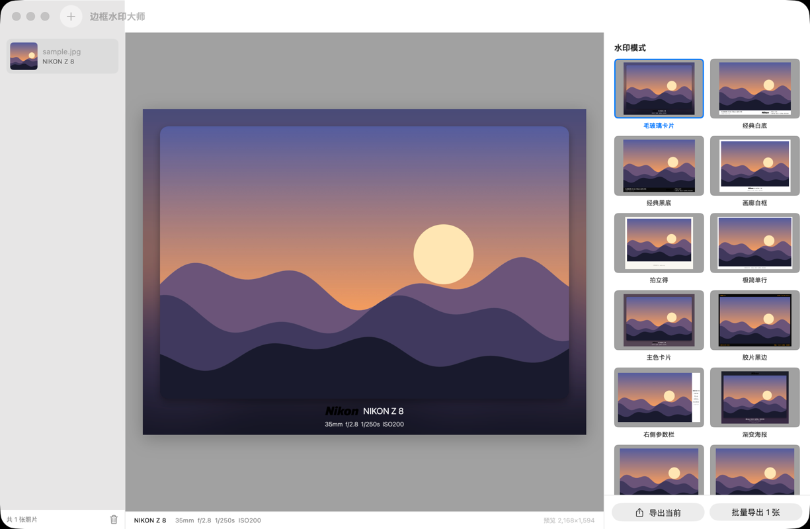
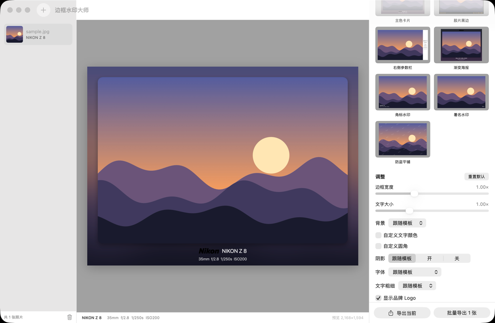

# 边框水印大师（BorderMark）

给照片加边框和拍摄参数水印的 macOS 应用。SwiftUI + 系统框架，无第三方依赖。

## 运行效果

打开一张带拍摄信息的照片后，中间是水印预览，右侧选择模式。下面是默认的「毛玻璃卡片」：模糊背景、圆角阴影，底部是品牌 Logo、机型和参数。



同一张预览下，侧栏往下是「调整」：边框宽度、文字大小、背景、阴影、字体，以及是否显示品牌 Logo。



## 运行

只需要 Command Line Tools（或完整 Xcode），macOS 14 以上。

```bash
swift run BorderMark          # 直接运行
./scripts/bundle.sh           # 打包成 build/边框水印大师.app
./scripts/test.sh             # 跑测试
./scripts/make-app-icon.sh    # 重新生成 App 图标（Packaging/AppIcon.icns）
```

## 命令行

```bash
swift run bordermark-cli list
swift run bordermark-cli render 照片.jpg --template blur-card --out 输出目录
swift run bordermark-cli render *.jpg --all --author "署名" --format heic
swift run bordermark-cli export-templates     # 把内置模式写成 JSON
```

## 结构

```
Sources/BorderMarkCore   核心库：EXIF 读取、模板模型、渲染器、导入导出（纯逻辑，有测试）
Sources/BorderMarkApp    SwiftUI 界面
Sources/BorderMarkCLI    命令行工具
```

## 界面

左侧照片列表，中间预览，右侧面板按功能分成五页，每页的参数分卡片放：

| 页 | 内容 |
|---|---|
| 模式 | 水印模式缩略图；自定义模式（JSON）的管理 |
| 样式 | 边框与照片（宽度、圆角、阴影）、背景、文字样式（大小、字体、粗细、颜色） |
| Logo | 来源与样式、颜色、Logo 文件 |
| 文字 | 每一行显示什么、署名与附言、手动填写的拍摄信息 |
| 导出 | 格式与质量 |

预览画质：参数一变先显示快速预览（长边约 2000 像素，拖滑块时跟得上），停顿约 0.35 秒后自动换成按原图分辨率渲染的成品，
和导出文件一致；预览下方会标明“原图画质”。主窗口和全屏都是如此。

预览：双击预览图、按空格或点工具栏按钮进入全屏预览，Esc / 空格退出；方向键 ←→↑↓ 在照片间切换
（主窗口和全屏都可用；正在输入文字时方向键留给输入框，按 Esc 或点一下预览区即可退出输入），
菜单“预览”里也有对应项（⌘[ / ⌘]）。全屏时单击画面或按 Z 切换到原图 100% 像素查看（以点击处为中心），
可拖动平移、触控板捏合缩放。

面板顶部的“重置默认”恢复所有默认值（署名等已输入的文字保留）；底部固定“导出当前”和“批量导出”按钮，
导出时弹窗显示进度，可取消。默认模式是毛玻璃卡片，导出质量默认 100。

## 自定义水印模式

每个模式是一份 JSON，放进 `~/Library/Application Support/BorderMark/Templates/`，
在应用里点“重新加载”即可。id 与内置模式相同时会覆盖内置模式。
点“写出示例”可以得到全部内置模式的 JSON，照着改最快。

所有长度都是**相对照片短边的比例**（0.05 = 短边的 5%），所以预览和原图导出版式一致。

```json
{
  "id": "my-style",
  "name": "我的样式",
  "summary": "鼠标悬停时显示的说明",
  "border": { "top": 0.04, "left": 0.04, "bottom": 0.16, "right": 0.04 },
  "background": { "solid": { "color": "#FFFFFF" } },
  "photo": { "cornerRadius": 0.01, "shadow": { "radius": 0.03, "offsetY": 0.012, "opacity": 0.35 } },
  "fontName": "Georgia",
  "elements": [
    {
      "group": {
        "region": "bottom", "h": "center", "v": "center",
        "insetX": 0, "insetY": 0, "spacing": 0.02,
        "items": [
          { "logo": { "height": 0.04, "color": "#111111" } },
          { "divider": { "height": 0.05, "width": 0.002, "color": "#CCCCCC" } },
          { "text": {
              "align": "leading", "lineSpacing": 0.008,
              "lines": [
                { "text": "{Model}", "size": 0.03, "weight": "bold", "color": "#111111" },
                { "text": "{Params}", "size": 0.02, "weight": "regular", "color": "#888888" }
              ]
          } }
        ]
      }
    }
  ]
}
```

| 字段 | 可选值 |
|---|---|
| `background` | `solid{color}`、`gradient{from,to}`、`blur{radius,dim}`、`dominant{dim}` |
| `region` | `canvas`、`photo`、`top`、`bottom`、`left`、`right`（后四个是对应的边框带） |
| `h` / `v` | `leading` `center` `trailing` / `top` `center` `bottom` |
| `weight` | `light` `regular` `medium` `semibold` `bold` |
| 元素 | `group`（横排的文字、Logo、分隔线）、`stack`（多行上下堆叠，`rows` 里每一行是一组横排项目，另有 `rowSpacing`）或 `tile`（斜向平铺文字：`text,size,weight,color,angle,spacingX,spacingY,region`） |
| 颜色 | `#RGB`、`#RRGGBB`、`#RRGGBBAA` |

占位符：`{Make}` `{Model}` `{Camera}`（完整相机名，如 Nikon Z5_2）`{Lens}` `{FocalLength}` `{FocalLength35}` `{FNumber}` `{Shutter}` `{ISO}`
`{Params}`（焦距+光圈+快门+ISO）`{Date}` `{Time}` `{DateTime}` `{GPS}` `{Author}` `{Copyright}` `{Custom}`。
某一行的占位符全部为空时，这一行自动不画。

## 品牌 Logo

应用自带 20 个品牌的 Logo 图片（`Sources/BorderMarkCore/Resources/Logos`），打包时放进 `.app`。
界面“调整”里可以选：

- **自动匹配相机品牌**（默认）：按每张照片 EXIF 的厂商字段找同名 Logo，批量导出时不同相机各用各的。
- **仅品牌名文字**、**指定某个品牌**（有多种样式的品牌是子菜单）、**自选一张图片**。
- **多种样式**：文件名 `Nikon.png` 是品牌默认 Logo，`Nikon-黄标.png`、`Leica-红标.png` 这样加 `-样式名` 的是同品牌的其他样式。
  在 Logo 页选了某个品牌的样式后会记住，之后自动匹配到这个品牌都用它，批量导出时不同相机各用各的。
- **Logo 颜色**：跟随文字（默认）、自定义颜色，或保留图片原色（彩色 Logo 用这个）。前两项只对透明底的 Logo 生效。

图片来源：

- 单色默认样式：Apple、DJI、FUJIFILM、Google、HUAWEI、Leica、Nikon、OPPO、Panasonic、SAMSUNG、SONY、vivo、Xiaomi
  取自 [Simple Icons](https://simpleicons.org) 16.37.0（CC0-1.0）；Canon、HASSELBLAD、OLYMPUS、PENTAX、SIGMA
  取自[维基共享资源](https://commons.wikimedia.org)（标注为公有领域）。
- 彩色样式（`品牌-彩色.png`）：Canon、FUJIFILM、Google、Leica、Nikon、OLYMPUS、OM SYSTEM、OPPO、Panasonic、
  PENTAX、RICOH、SAMSUNG、SIGMA、vivo、Xiaomi，取自维基共享资源（标注为公有领域）。另有 `HUAWEI-字标.png`。
- OM SYSTEM、RICOH 的单色默认样式仍是 `scripts/make-wordmark-logos.swift` 生成的品牌名字标。
- SVG 用 `scripts/svg-to-logo.swift` 转成透明底 PNG。

**彩色样式只在 Logo 颜色选“原色”时出现**：切到原色后自动换成彩色样式，也可以在样式下拉里改回单色；
“跟随文字 / 自定义”两种染色模式下只列出单色样式。两种模式下选的样式分别记住。

各品牌 Logo 是其所有者的商标，CC0 / 公有领域只说明图片文件本身没有版权限制。自用没有问题；公开分发或上架前请自行确认商标使用是否合规。

要替换或补充：把以品牌命名的透明底 PNG（如 `Canon.png`）放进
`~/Library/Application Support/BorderMark/Logos/`（界面里点“Logo 文件夹”），同名会替换自带的；
或者直接替换源码目录里的文件后重新打包。文件名需是 EXIF 厂商字段的开头部分，不区分大小写。
